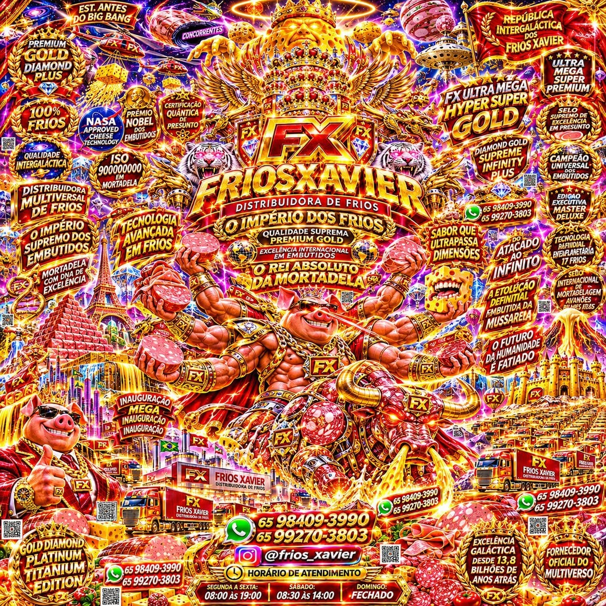

# ultraslop

An agentic skill that turns any image / generates images which look horrible, ugly and AI slop.

## Example output



## Install

### OpenCode

```sh
git clone https://github.com/monabji/ultraslop-skill ~/.config/opencode/skills/ultraslop
```

### Claude Code

```sh
git clone https://github.com/monabji/ultraslop-skill ~/.claude/skills/ultraslop
```

### Codex

Codex uses the same open `SKILL.md` standard. Put it in the shared agent skills folder (recommended):

```sh
git clone https://github.com/monabji/ultraslop-skill ~/.agents/skills/ultraslop
```

Or into Codex's own folder (still supported):

```sh
git clone https://github.com/monabji/ultraslop-skill ~/.codex/skills/ultraslop
```

For a single project, clone into `<project>/.agents/skills/ultraslop` instead. If the folder is named `ultraslop-skill`, rename it to `ultraslop` so it matches the `name` field in `SKILL.md` — Agent Skills requires the directory name to match.

Invoke it explicitly with `$ultraslop <your request>` in the CLI/IDE extension, or let Codex pick it up implicitly when your request mentions maximalism, horror vacui, or visual overload. Run `/skills` to confirm it's loaded.

## Use

Give the agent an image and say "ultraslop it" (or ask for maximalism / horror vacui / visual overload). The skill instructs the agent to:

1. **Base pass** — amplify the subject in a monumental, impossible setting.
2. **Density pass** — fill every region with ornaments, seals, medals, mascots, chrome/gold 3D type, redundant slogans, light bursts.
3. **Prototype forks** — density strategy, type treatment, and palette are settled by A/B experiments, not taste; the agent recommends from what it observes.
4. **Verify** — 64px thumbnail test, per-quarter empty-patch audit, ≥5-item redundancy count.
5. **Ask you** — reference flavor (lotería, truck art, 90s box art…) and how clean the hero zone stays.

## License

MIT
